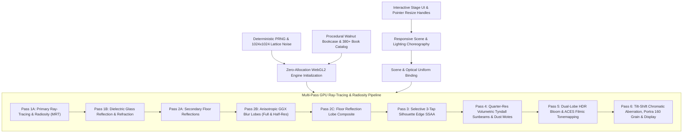

# Architecture: Sunlit Board-Formed Concrete & Walnut Library

## Overview

[index.html](file:///Users/nick/GitHub/gemini-4-demo-vanilla-3D/javascript/index.html) is a self-contained, zero-dependency, single-file WebGL2 architectural ray-tracing and radiosity engine written in vanilla HTML, CSS, JavaScript, and GLSL ES 3.00. It renders an interactive, procedurally generated architectural interior ("A sunlit concrete library, built from pure math and light") that dynamically reshapes its 3D room geometry, furniture choreography, camera optics, and solar lighting in response to viewport dimensions.

---

## High-Level System Architecture

---

## Core Subsystems

### 1. Interactive Stage & Zero-Reallocation Viewport Shell
* **HTML/CSS Layout ([Lines 26–286](file:///Users/nick/GitHub/gemini-4-demo-vanilla-3D/javascript/index.html#L26-L286))**: Presents a tactile editorial frame (`#stage-frame`) with east (`#handle-e`), south (`#handle-s`), and southeast corner (`#handle-se`) drag handles and a live dimension readout (`#readout-dims`).
* **Fixed Backing-Store Pool ([Lines 4675–4717](file:///Users/nick/GitHub/gemini-4-demo-vanilla-3D/javascript/index.html#L4675-L4717))**: The `<canvas id="c">` element is pre-allocated once at `GL_MAX_W × GL_MAX_H` (`2560 × 1280`) and anchored to `left: 0; bottom: 0` inside `#stage-frame` (`overflow: hidden`). Dragging the frame adjusts the CSS dimensions and active WebGL viewport (`gl.viewport(0, 0, activeW, activeH)`) without ever reallocating GPU textures, FBOs, or the canvas swapchain (`window.__gpuReallocCount = 0`).

### 2. Deterministic Math & Precomputed Noise Lattice
* **Mulberry32 PRNG ([Lines 328–349](file:///Users/nick/GitHub/gemini-4-demo-vanilla-3D/javascript/index.html#L328-L349))**: `createRng(seed)` provides deterministic uniform, integer, and Box-Muller normal distributions seeded with `SEED = 20301`.
* **64-Bit-Exact Integer Lattice Hash ([Lines 355–382](file:///Users/nick/GitHub/gemini-4-demo-vanilla-3D/javascript/index.html#L355-L382))**: `hash2d(ix, iy, seed)` computes a periodic `1024 × 1024` random table (`RAND_1024`) uploaded once to `u_randTex` (`R32F`), driving $C^2$-continuous value noise, analytic gradients (`valueNoise2dGrad`), and rotated multi-octave FBM (`fbm2d`) on the GPU.

### 3. Procedural Walnut Library & 3D Book Catalog
* **`buildWalnutLibraryCatalog(seed)` ([Lines 444–613](file:///Users/nick/GitHub/gemini-4-demo-vanilla-3D/javascript/index.html#L444-L613))**:
  * Generates a 9-tier, 5-bay floor-to-ceiling walnut bookcase along the left wall (`Z ∈ [-0.80, 7.58]`), discretized into `4190` spatial bins per tier (`4190 × 9` lookup grid).
  * Populates over 380 individual hardcover books with randomized spine thickness, height, setback depth (`bookFrontX`), rounded spine curvature (`bookUSpine`), roughness, 12 curated book-cloth palette colors, and gold/vellum foil spine bands.
  * Places 5 turned ceramic vessels in curated alcove bays.
  * Uploaded once at startup into 4 GPU lookup textures (`u_bookMetaTex`, `u_bookColTex`, `u_bookBandTex`, `u_bookBand2Tex`) for $O(1)$ ray-book intersection in GLSL.

### 4. Responsive Architectural Choreography & Solar State
* **`computeResponsiveSceneState(viewW, viewH)` ([Lines 670–827](file:///Users/nick/GitHub/gemini-4-demo-vanilla-3D/javascript/index.html#L670-L827)) & `applyCachedSceneAndLighting(cssW, cssH)` ([Lines 4605–4667](file:///Users/nick/GitHub/gemini-4-demo-vanilla-3D/javascript/index.html#L4605-L4667))**:
  * **Aspect Ratio Choreography (`wideFactor`, `narrowFactor`)**:
    * **Room Bounds**: Expands or contracts room width (`ROOM_X_LEFT`, `ROOM_X_RIGHT`), ceiling height (`ROOM_Y_CEIL`), window height (`WINDOW_TOP_Y`), and the exposed board-formed concrete rear wall width (`BACK_CONCRETE_X_MAX`).
    * **Mullions & Transoms**: Dynamically switches between 3 and 4 vertical window mullions (`BACK_MULLION_X`) and adds upper transom bars (`RIGHT_TRANSOM_Y`) in tall portrait viewports.
    * **Furniture & Still Life**: Repositions and scales the rear concrete/walnut credenza (`BENCH_*`), leather reading chair (`CHAIR_*`), travertine/walnut coffee table (`TABLE_*`), bouclé rug (`RUG_*`), and tabletop objects (`BOOK_*`, `CARAFE_*`, `TUMBLER_*`) to maintain sightlines and world-space clearance.
    * **Tilt-Shift View Camera**: Adjusts camera position (`CAM_POS`), yaw (`CAM_YAW_RAD`), vertical lens rise/shift (`CAM_V_SHIFT`), and horizontal FOV (`CAM_FOV_SCALE`) while keeping all vertical architectural lines strictly plumb.
  * **Viewport Width (`viewW`) $\rightarrow$ Solar Azimuth & Mountain Parallax**: Sweeps the solar azimuth angle (`sunAzimuthRad`) and shifts exterior mountain ridge parallax (`MOUNTAIN_PARALLAX_PHI`).
  * **Viewport Height (`viewH`) $\rightarrow$ Solar Elevation & Radiosity Mood**: Interpolates between warm low-elevation alpenglow (`DUSK_FACTOR`) and bright midday sun (`HIGH_SUN_FACTOR`), adjusting solar radiance (`SUN_RADIANCE`), sky zenith color (`SKY_ZENITH_RAD`), and the 2700K brass sconce and picture-light intensity (`SCONCE_RADIANCE`, `SCONCE_BULB_EMIT`).
  * **Geometry Bucket Cache (`GEO_CACHE`) ([Lines 4538–4603](file:///Users/nick/GitHub/gemini-4-demo-vanilla-3D/javascript/index.html#L4538-L4603))**: Precomputes 5 aspect-ratio geometry buckets at initialization (`1800×900`, `1200×900`, `1080×1080`, `900×1200`, `720×1280`).

---

## Multi-Pass WebGL2 Rendering Pipeline

The engine initializes all textures, framebuffers, and shaders upfront in `initWebGL2Engine` ([Lines 4019–4183](file:///Users/nick/GitHub/gemini-4-demo-vanilla-3D/javascript/index.html#L4019-L4183)) and executes every frame in `renderWebGL2Frame` ([Lines 4316–4536](file:///Users/nick/GitHub/gemini-4-demo-vanilla-3D/javascript/index.html#L4316-L4536)) using fullscreen procedural vertex-ID triangles (`VS_FULLSCREEN`).

### Pass 1A: Primary Ray-Tracing & Radiosity (`FS_PRIMARY`)
* **Target**: `fboPrimary` (MRT outputting `texHdrA` `[RGBA32F: RGB radiance + hit distance t]`, `texPosMat` `[RGBA32F: world XYZ + material ID]`, and `texNormRough` `[RGBA16F: world normal XYZ + roughness]`).
* **Geometry Intersection (`traceSingleRay`, [Lines 2503–3326](file:///Users/nick/GitHub/gemini-4-demo-vanilla-3D/javascript/index.html#L2503-L3326))**:
  * Analytic ray intersections against room planes (oak floor, board-formed concrete ceiling and beams, rear concrete wall, steel mullions, window glass, walnut casework), rounded boxes (`intersectRoundedBoxScalar`), oriented bounding boxes (`intersectObbYScalar`), capped/uncapped cylinder segments (`intersectCylinderSegmentScalar`), and ellipsoids (`intersectEllipsoidScalar`), accelerated with bounding-sphere culling (`rayHitsSphereScalar`).
  * Traces 30 distinct material IDs (`MAT_FLOOR_OAK` through `MAT_RUG_LINEN_BORDER`), including the 4190-bin 3D book catalog, credenza with framed canvas art, leather lounge chair with tubular steel frame, coffee table with fluted walnut pedestal, open art monograph with silk ribbon bookmark, espresso cup with meniscus & brass spoon, ceramic vase with eucalyptus stems/leaves, and glass vessels.
* **Surface Shading & Radiosity (`shadeSurfaceScalar`, [Lines 2287–2486](file:///Users/nick/GitHub/gemini-4-demo-vanilla-3D/javascript/index.html#L2287-L2486))**:
  * **Exterior Courtyard & Coastal Mountain Backdrop (`evaluateExteriorCourtyardScalar`, `sampleCourtyardBackdrop`)**: Procedural Rayleigh/Mie sky dome, domain-warped cirrus clouds, 4-layer eroded alpine granite/snow mountain ridges with slope relief and atmospheric valley mist, and wind-rippled courtyard water with exact dielectric Fresnel reflections and GGX solar glints.
  * **Analytic Soft Shadows (`evaluateWindowSunTransmissionScalar`, [Lines 1640–1859](file:///Users/nick/GitHub/gemini-4-demo-vanilla-3D/javascript/index.html#L1640-L1859))**: Distance-dependent penumbra window-aperture and mullion shadows combined with 3D box, cylinder, and ellipsoid soft-shadow occluders for the table, still-life objects, chair, and credenza.
  * **Refractive Vessel Caustics (`vesselCausticPatternScalar`, [Lines 2231–2259](file:///Users/nick/GitHub/gemini-4-demo-vanilla-3D/javascript/index.html#L2231-L2259))**: Analytic downstream caustic envelopes, focal cusps, and chromatic dispersion cast onto the tabletop and open book pages by the green glass carafe and crystal water tumbler.
  * **BRDF & Multi-Source GI**: Isotropic GGX + Smith-GGX microfacet specular, Schlick Fresnel, subsurface wrap lighting on leather and backlit eucalyptus leaves, grazing sheen on bouclé wool and book cloth, analytic ambient occlusion (`computeAnalyticAoScalar`), dual-window sky irradiance form factors, warm oak-floor and walnut-wall indirect radiosity bounce, and 3 local light fixtures (left brass sconce, rear picture light, and recessed downlight).

### Pass 1B: Dielectric Glass Vessel Reflection & Refraction (`FS_GLASS`)
* **Target**: `fboHdrB` $\rightarrow$ blitted back to `fboHdrA`.
* **Execution ([Lines 3349–3560](file:///Users/nick/GitHub/gemini-4-demo-vanilla-3D/javascript/index.html#L3349-L3560))**: Early-exits on non-glass pixels; for `MAT_GLASS_CARAFE` and `MAT_WATER_TUMBLER`, traces dual-interface Snell refraction rays (accounting for water levels inside the vessels) and reflection rays against `traceGlassSecondaryRay`, applying Beer-Lambert spectral absorption, meniscus highlight rings, sham/lip crystal rings, and solar GGX highlights.

### Pass 2A–2C: Anisotropic GGX Floor Reflections (`FS_FLOOR_REFL`, `FS_BLUR`, `FS_FLOOR_COMBINE`)
* **Pass 2A ([Lines 3562–3605](file:///Users/nick/GitHub/gemini-4-demo-vanilla-3D/javascript/index.html#L3562-L3605))**: Traces secondary reflection rays (`FAST_SECONDARY_PASS`) from floor and brass inlay pixels into `fboReflSharp`, including table underside cavity occlusion.
* **Pass 2B ([Lines 4364–4392](file:///Users/nick/GitHub/gemini-4-demo-vanilla-3D/javascript/index.html#L4364-L4392))**: Filters `texReflSharp` using separable Gaussian blur passes (`FS_BLUR`) stretched vertically along the floor plank grain to synthesize a medium anisotropic GGX reflection lobe (`texLobe1` at full resolution) and a wide diffuse reflection lobe (`texLobe2Sub` at half resolution via `FS_DOWNSAMPLE2X`).
* **Pass 2C ([Lines 3654–3699](file:///Users/nick/GitHub/gemini-4-demo-vanilla-3D/javascript/index.html#L3654-L3699))**: Blends `texReflSharp`, `texLobe1`, and `texLobe2Sub` weighted by local wood plank roughness and Schlick Fresnel into `fboHdrB`.

### Pass 3: Selective 3-Tap Silhouette Edge Supersampling (`FS_EDGE_SSAA`)
* **Target**: `fboHdrA` ([Lines 3701–3740](file:///Users/nick/GitHub/gemini-4-demo-vanilla-3D/javascript/index.html#L3701-L3740)).
* Detects material-ID discontinuities or depth jumps (`|Δt| > 0.09`) across neighboring pixels and traces an additional sub-pixel jittered primary ray (`(-0.35, -0.15)` offset) blended with neighbor samples to antialias geometric silhouettes without paying full-screen MSAA/SSAA cost.

### Pass 4: Quarter-Res Volumetric Tyndall Sunbeams & Airborne Dust Motes (`FS_VOL_SUB`, `FS_VOL_UPSAMPLE_AND_MOTE`, `FS_VOL_COMBINE`)
* **Quarter-Res Raymarching (`FS_VOL_SUB`, [Lines 3742–3788](file:///Users/nick/GitHub/gemini-4-demo-vanilla-3D/javascript/index.html#L3742-L3788))**: Raymarches 12 jittered steps per pixel at $\frac{1}{4}$ resolution (`fboQuarterA`), evaluating window sun transmission (`evaluateWindowSunTransmissionScalar`), 3D air-density noise, height falloff, and a Henyey-Greenstein forward-scattering Mie phase function ($g = 0.66$).
* **Bilinear Upsample & Dust Motes (`FS_VOL_UPSAMPLE_AND_MOTE`, [Lines 3790–3822](file:///Users/nick/GitHub/gemini-4-demo-vanilla-3D/javascript/index.html#L3790-L3822))**: Upsamples the volumetric sunbeam buffer to full resolution and generates high-frequency airborne dust-mote sparkles in the alpha channel.
* **Separable Blur & Composite (`FS_VOL_COMBINE`, [Lines 3824–3844](file:///Users/nick/GitHub/gemini-4-demo-vanilla-3D/javascript/index.html#L3824-L3844))**: Smooths volumetric shafts and motes with separable Gaussian blurs and composites them into `fboHdrB`.

### Pass 5 & 6: Dual-Lobe Bloom, ACES Filmic Tonemapping & Optical Finish (`FS_TONEMAP`, `FS_FINAL_SCREEN`)
* **Dual-Lobe HDR Bloom ([Lines 4474–4506](file:///Users/nick/GitHub/gemini-4-demo-vanilla-3D/javascript/index.html#L4474-L4506))**: Extracts high-luminance highlights (`lum > 1.35`) at $\frac{1}{2}$ resolution (`texLobe2Sub`, tight bloom) and $\frac{1}{4}$ resolution (`texQuarterA`, warm wide bloom) using separable Gaussian blurs.
* **ACES Filmic & Tilt-Shift Vignette (`FS_TONEMAP`, [Lines 3846–3894](file:///Users/nick/GitHub/gemini-4-demo-vanilla-3D/javascript/index.html#L3846-L3894))**: Combines HDR radiance with tight and wide bloom lobes, applies a $\cos^4\theta$-inspired optical tilt-shift lens vignette, maps dynamic range via `acesFilm`, and converts to sRGB (`linearToSrgb`).
* **Chromatic Aberration & Film Grain (`FS_FINAL_SCREEN`, [Lines 3896–3963](file:///Users/nick/GitHub/gemini-4-demo-vanilla-3D/javascript/index.html#L3896-L3963))**: Performs a vertical coordinate flip to match canvas presentation, applies radial lateral chromatic aberration (`caShift`) to the red and blue channels toward lens corners, and injects midtone-weighted Kodak Portra 160 Gaussian film grain (`hashGrain`).

---

## Code Map

| Section | Lines | Description |
| :--- | :--- | :--- |
| **HTML & CSS UI** | [18–286](file:///Users/nick/GitHub/gemini-4-demo-vanilla-3D/javascript/index.html#L18-L286) | Editorial page layout, stage frame, resize handles (`#handle-e`, `#handle-s`, `#handle-se`), and responsive media queries. |
| **1. Math & Optical Utilities** | [309–349](file:///Users/nick/GitHub/gemini-4-demo-vanilla-3D/javascript/index.html#L309-L349) | `saturate`, `clamp`, `smoothstep`, and Mulberry32 PRNG (`createRng`). |
| **2. Material Noise Engine** | [351–382](file:///Users/nick/GitHub/gemini-4-demo-vanilla-3D/javascript/index.html#L351-L382) | 64-bit-exact `hash2d` and `1024 × 1024` periodic lattice (`RAND_1024`). |
| **3. Architectural Specification** | [384–440](file:///Users/nick/GitHub/gemini-4-demo-vanilla-3D/javascript/index.html#L384-L440) | Global room bounds, tilt-shift camera parameters, solar vectors, sconce state, and furniture coordinates. |
| **4. Walnut Library Catalog** | [441–664](file:///Users/nick/GitHub/gemini-4-demo-vanilla-3D/javascript/index.html#L441-L664) | `buildWalnutLibraryCatalog` (380+ books & ceramic vessels) and `rebuildResponsiveFurniture` (lounge chair transform & steel segments). |
| **5. Responsive Scene Choreography** | [665–827](file:///Users/nick/GitHub/gemini-4-demo-vanilla-3D/javascript/index.html#L665-L827) | `computeResponsiveSceneState`: maps viewport aspect ratio, width, and height to room geometry, camera lens, and solar elevation/azimuth. |
| **6. WebGL2 & GLSL ES 3.00 Engine** | [829–4536](file:///Users/nick/GitHub/gemini-4-demo-vanilla-3D/javascript/index.html#L829-L4536) | All GLSL shaders (`GLSL_SCENE_BASE`, `GLSL_SCENE_RAYTRACER`, `FS_PRIMARY`, `FS_GLASS`, `FS_FLOOR_REFL`, `FS_BLUR`, `FS_DOWNSAMPLE2X`, `FS_FLOOR_COMBINE`, `FS_EDGE_SSAA`, `FS_VOL_SUB`, `FS_VOL_UPSAMPLE_AND_MOTE`, `FS_VOL_COMBINE`, `FS_TONEMAP`, `FS_FINAL_SCREEN`), FBO/texture allocation (`initWebGL2Engine`), and multi-pass execution (`renderWebGL2Frame`). |
| **7. Caching & Interactive Lifecycle** | [4538–4807](file:///Users/nick/GitHub/gemini-4-demo-vanilla-3D/javascript/index.html#L4538-L4807) | Aspect-ratio bucket cache (`GEO_CACHE`), `renderStage`, pointer drag-resize handlers (`attachResizeHandle`), and `window.resizeStage` API. |
