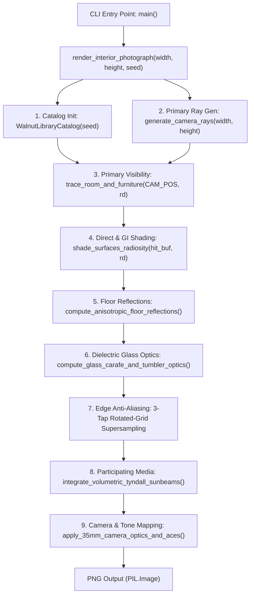

# Architecture Overview: Sunlit Concrete & Walnut Library Engine

## 1. System Overview

[`sunlit_library.py`](file:///Users/nick/GitHub/gemini-4-demo-vanilla-3D/python/sunlit_library.py) is a self-contained, physically-based 3D architectural ray-tracing, radiosity, and volumetric rendering engine written in pure Python and vectorized 64-bit floating-point NumPy (`float64`). It requires no external 3D assets, textures, meshes, or GPU shader APIs—every geometric primitive, book spine, material patina, cloud deck, refractive caustic, and optical lens effect is synthesized procedurally in memory and output to an image via Pillow (`PIL`).

### Key Capabilities
- **35mm Tilt-Shift Two-Point Perspective Camera**: Strictly plumb verticals (zero pitch), yaw-rotated optical axis, and vertical shift (`CAM_V_SHIFT`), supporting both `4:3` (`1600x1200`) and `16:9` (`1920x1080`) aspect ratios.
- **Vectorized Analytic 3D Ray-Tracing**: Exact ray intersections against axis-aligned bounding boxes (AABBs), beveled rounded boxes, yaw/tilt-oriented bounding boxes (OBBs), finite capped/uncapped cylinder segments, and oriented ellipsoids, accelerated via $O(N)$ vectorized bounding-sphere ray culling and 1D binned table lookups.
- **Procedural Architectural & Still-Life Catalog**: Deterministic generation of 340+ hardcover books, leaning volumes, folio stacks, travertine bookends, wheel-thrown stoneware vessels, a tufted cognac saddle-leather lounge chair on a cantilevered steel sled frame, a walnut & travertine credenza with a leaning bas-relief artwork, and a foreground coffee table still life (eucalyptus branch in stoneware vase, ribbed glass carafe, crystal tumbler on brass coaster, stoneware cappuccino cup/saucer/spoon, and open art monograph with silk ribbon).
- **Physically-Based Shading & Radiosity**: Cook-Torrance microfacet specular (isotropic and anisotropic Trowbridge-Reitz GGX + Smith height-correlated shadowing-masking), Oren-Nayar rough micro-cavity diffuse, exact unpolarized dielectric Fresnel, multi-patch bounce radiosity, area-window sky irradiance, and 3D swept soft penumbra shadows.
- **Secondary Optics & Volumetrics**: Anisotropic vertically-stretched GGX floor reflections, 2-interface Snell refraction with Beer-Lambert absorption and Cauchy chromatic dispersion caustics, and 28-step ray-marched Henyey-Greenstein volumetric Tyndall sunbeams with sub-pixel dust motes.

---

## 2. Rendering Pipeline Architecture



---

## 3. Codebase Structure (`sunlit_library.py`)

The engine is organized into 15 sequential functional sections inside [`sunlit_library.py`](file:///Users/nick/GitHub/gemini-4-demo-vanilla-3D/python/sunlit_library.py):

| Section | Lines | Responsibility | Key Symbols |
| :--- | :--- | :--- | :--- |
| **1. Math, Optical & BRDF Utilities** | `L62-L249` | Vector algebra, Snell refraction, Fresnel equations, GGX & Oren-Nayar BRDFs | [`refract`](file:///Users/nick/GitHub/gemini-4-demo-vanilla-3D/python/sunlit_library.py#L108-L121), [`dielectric_fresnel_exact`](file:///Users/nick/GitHub/gemini-4-demo-vanilla-3D/python/sunlit_library.py#L134-L143), [`cook_torrance_brdf`](file:///Users/nick/GitHub/gemini-4-demo-vanilla-3D/python/sunlit_library.py#L214-L248) |
| **2. Precomputed Noise & Cellular Engine** | `L251-L475` | Periodic $1024 \times 1024$ lattice noise, analytical gradients, FBM, billow noise, cellular bug-holes, separable Gaussian blur | [`value_noise_2d_grad`](file:///Users/nick/GitHub/gemini-4-demo-vanilla-3D/python/sunlit_library.py#L309-L346), [`fbm2d`](file:///Users/nick/GitHub/gemini-4-demo-vanilla-3D/python/sunlit_library.py#L349-L370), [`cellular_bugholes_2d`](file:///Users/nick/GitHub/gemini-4-demo-vanilla-3D/python/sunlit_library.py#L403-L442) |
| **3. Room, Sky & Material Constants** | `L477-L554` | World-space bounds, camera constants, calibrated sun/sky radiances, material IDs (`MAT_*`) | `ROOM_*`, `CAM_*`, `SUN_DIR`, `MAT_*` |
| **4. Camera & Ray Culling** | `L557-L619` | Orthonormal two-point perspective camera basis, frustum ray generation, $O(N)$ bounding-sphere culling | [`build_camera_basis`](file:///Users/nick/GitHub/gemini-4-demo-vanilla-3D/python/sunlit_library.py#L562-L568), [`generate_camera_rays`](file:///Users/nick/GitHub/gemini-4-demo-vanilla-3D/python/sunlit_library.py#L571-L599), [`rays_hitting_sphere`](file:///Users/nick/GitHub/gemini-4-demo-vanilla-3D/python/sunlit_library.py#L602-L618) |
| **5. Analytic Ray-Primitive Kernels** | `L621-L846` | Vectorized ray-slab, beveled box, yaw/tilt OBB, finite cylinder, and oriented ellipsoid intersections | [`intersect_aabb`](file:///Users/nick/GitHub/gemini-4-demo-vanilla-3D/python/sunlit_library.py#L626-L653), [`intersect_obb_y`](file:///Users/nick/GitHub/gemini-4-demo-vanilla-3D/python/sunlit_library.py#L681-L733), [`intersect_cylinder_segment`](file:///Users/nick/GitHub/gemini-4-demo-vanilla-3D/python/sunlit_library.py#L736-L798), [`intersect_ellipsoid`](file:///Users/nick/GitHub/gemini-4-demo-vanilla-3D/python/sunlit_library.py#L801-L845) |
| **6. Walnut Library Catalog** | `L848-L1157` | Deterministic procedural layout & binned acceleration table for shelves, books, folios, bookends, and vessels | [`WalnutLibraryCatalog`](file:///Users/nick/GitHub/gemini-4-demo-vanilla-3D/python/sunlit_library.py#L854-L1156) |
| **7. Volumetric Sky & Coastal Exterior** | `L1159-L1523` | 3-deck domain-warped cloud sky, directional solar optical depth, coastal headlands, capillary-gravity water waves | [`evaluate_realistic_cloud_sky`](file:///Users/nick/GitHub/gemini-4-demo-vanilla-3D/python/sunlit_library.py#L1164-L1337), [`evaluate_exterior_courtyard`](file:///Users/nick/GitHub/gemini-4-demo-vanilla-3D/python/sunlit_library.py#L1340-L1522) |
| **8. Window Sun Transmission & Shadows** | `L1525-L2029` | Soft solar-disc penumbra through window apertures/mullions and 3D swept shadow kernels for interior objects | [`evaluate_window_sun_transmission`](file:///Users/nick/GitHub/gemini-4-demo-vanilla-3D/python/sunlit_library.py#L1530-L2028) |
| **9. Procedural Material Shaders** | `L2032-L2664` | Tactile surface shaders for board-formed concrete, oak & travertine floor, bouclé rug, American walnut, and cognac leather | [`material_board_formed_concrete`](file:///Users/nick/GitHub/gemini-4-demo-vanilla-3D/python/sunlit_library.py#L2037-L2223), [`material_oiled_oak_and_travertine_floor`](file:///Users/nick/GitHub/gemini-4-demo-vanilla-3D/python/sunlit_library.py#L2226-L2393), [`material_woven_boucle_rug`](file:///Users/nick/GitHub/gemini-4-demo-vanilla-3D/python/sunlit_library.py#L2396-L2493), [`material_american_walnut`](file:///Users/nick/GitHub/gemini-4-demo-vanilla-3D/python/sunlit_library.py#L2496-L2580), [`material_cognac_saddle_leather`](file:///Users/nick/GitHub/gemini-4-demo-vanilla-3D/python/sunlit_library.py#L2583-L2663) |
| **10. Scene Ray-Tracing Engine** | `L2667-L4578` | Unified primary/secondary ray tracer with G-buffer output (`t`, `pos`, `normal`, `mat_id`, `albedo`, `roughness`, `f0`, `metallic`, `uv`) | [`trace_room_and_furniture`](file:///Users/nick/GitHub/gemini-4-demo-vanilla-3D/python/sunlit_library.py#L2672-L4577) |
| **11. Global Illumination & Caustics** | `L4581-L5116` | Multi-scale analytic AO, dispersive cardioid/nephroid caustics, direct sun, sky dome, bounce radiosity, sconces, and shelf LEDs | [`compute_analytic_ambient_occlusion`](file:///Users/nick/GitHub/gemini-4-demo-vanilla-3D/python/sunlit_library.py#L4586-L4709), [`evaluate_refractive_caustics`](file:///Users/nick/GitHub/gemini-4-demo-vanilla-3D/python/sunlit_library.py#L4712-L4807), [`shade_surfaces_radiosity`](file:///Users/nick/GitHub/gemini-4-demo-vanilla-3D/python/sunlit_library.py#L4810-L5115) |
| **12. Floor Reflections & Glass Optics** | `L5118-L5344` | Secondary ray tracing for anisotropic GGX floor reflections and 2-bounce refractive/reflective glassware | [`compute_anisotropic_floor_reflections`](file:///Users/nick/GitHub/gemini-4-demo-vanilla-3D/python/sunlit_library.py#L5123-L5205), [`compute_glass_carafe_and_tumbler_optics`](file:///Users/nick/GitHub/gemini-4-demo-vanilla-3D/python/sunlit_library.py#L5208-L5343) |
| **13. Volumetric Tyndall Sunbeams** | `L5346-L5533` | 28-step jittered ray-marching with Henyey-Greenstein phase function and 2D Gaussian dust motes | [`integrate_volumetric_tyndall_sunbeams`](file:///Users/nick/GitHub/gemini-4-demo-vanilla-3D/python/sunlit_library.py#L5351-L5532) |
| **14. Camera Optics & ACES Tone Mapping** | `L5535-L5615` | Dual-stage HDR bloom, $\cos^4$-style lens vignetting, ACES filmic curve, lateral chromatic aberration, Kodak Portra grain | [`apply_35mm_camera_optics_and_aces`](file:///Users/nick/GitHub/gemini-4-demo-vanilla-3D/python/sunlit_library.py#L5540-L5614) |
| **15. Main Entry Point & Supersampling** | `L5617-L5711` | Edge-detected 3-tap rotated-grid supersampling (RGSS) and CLI/environment orchestration | [`render_interior_photograph`](file:///Users/nick/GitHub/gemini-4-demo-vanilla-3D/python/sunlit_library.py#L5622-L5685), [`main`](file:///Users/nick/GitHub/gemini-4-demo-vanilla-3D/python/sunlit_library.py#L5688-L5708) |

---

## 4. Coordinate System & Scene Layout

The scene is defined in a right-handed metric coordinate system (meters):
- **X-Axis (`[-3.10, +3.20]`)**: Runs left-to-right from the recessed backboard of the floor-to-ceiling American walnut library (`X = -3.10`, front face at `X = -2.72`) to the right floor-to-ceiling blackened-steel window curtain wall (`X = +3.20`).
- **Y-Axis (`[0.00, +4.25]`)**: Runs vertically from the wide-plank oiled European oak and honed Roman travertine floor (`Y = 0.00`) to the coffered board-formed concrete ceiling (`Y = +4.25`).
- **Z-Axis (`[-1.80, +7.60]`)**: Runs depth-wise from the camera foreground (`CAM_POS = [-0.18, 1.38, -1.52]`) to the back board-formed concrete wall (`X <= 1.08, Z = +7.60`) and corner window return (`X > 1.08, Z = +7.60`).

### Primary Architectural Zones
1. **Left Walnut Library (`X in [-3.10, -2.72]`, `Z in [-0.80, 7.58]`)**: 7 shelf tiers (`BOOKCASE_SHELF_Y`) and 5 bays (`BOOKCASE_STILE_Z`) housing 340+ vertical books, leaning volumes, horizontal folio stacks, travertine bookends, ribbed stoneware vessels, and an articulated brass reading sconce at `[-2.68, 2.26, 2.55]`.
2. **Back Wall & Credenza Vignette (`Z in [6.88, 7.60]`)**: Board-formed mineral concrete wall with two gallery brass sconces (`X = -1.58` picture light and `X = 0.25` cylindrical downlight) illuminating a 6-door walnut & travertine credenza (`X = -0.85, Z = 7.22`), a leaning framed bas-relief artwork, a Taschen-style folio stack, and fluted travertine/bronze vessels.
3. **Midground Lounge Seating (`X = -1.18, Z = 2.28`)**: Sculpted cognac saddle-leather lounge chair (`yaw = -0.56 rad`) with 3-channel tufted seat/backrest, integrated cylindrical headrest bolster with bridle-leather straps and brass buckles, and wrapped armrests on a cantilevered steel sled frame pressing into a 13mm raised Belgian wool bouclé rug (`X in [-1.88, 1.04], Z in [0.94, 3.10]`).
4. **Foreground Coffee Table Still Life (`X = 0.30, Z = 1.77`)**: Honed Roman travertine tabletop (`Y = 0.390`) on fluted walnut tambour plinth legs with brass toe-kicks, supporting:
   - Hand-thrown stoneware vase (`[0.44, 0.390, 1.98]`) with 3 woody stems and 11 oriented silver-dollar eucalyptus leaves.
   - Optic-mold 18-ribbed clear glass water carafe (`[0.52, 0.390, 1.52]`) and 12-faceted crystal water tumbler (`[0.70, 0.3955, 1.42]`) on a turned brass coaster.
   - Open hardcover art monograph (`[0.04, 0.396, 1.50]`) with arched pages, architectural plates/typography, and a draped burgundy silk ribbon.
   - Stacked closed monographs (`[-0.12, 0.405, 2.04]`) and a stoneware cappuccino cup, dished saucer, recessed crema meniscus, and brass demitasse spoon (`[0.24, 0.390, 1.78]`).

---

## 5. Core Subsystems in Detail

### 5.1 Vectorized Ray-Tracing & Culling (`trace_room_and_furniture`)
Instead of a pointer-based BVH tree (which incurs high per-ray branching overhead in Python), [`trace_room_and_furniture`](file:///Users/nick/GitHub/gemini-4-demo-vanilla-3D/python/sunlit_library.py#L2672-L4577) uses a **two-tier vectorized culling architecture**:
1. **Analytical Room Slab & Curtain-Wall Pass**: Intersects all $N$ rays simultaneously against the 5 room boundary planes and 3D extruded window mullions/transoms.
2. **Localized Bounding-Sphere Sub-Masking**: Complex furniture clusters (sconces, back credenza vignette, leather lounge chair, coffee table, book/espresso cluster, and vase/glassware cluster) are guarded by [`rays_hitting_sphere`](file:///Users/nick/GitHub/gemini-4-demo-vanilla-3D/python/sunlit_library.py#L602-L618). Only the subset of ray indices `idx = np.where(mask)[0]` intersecting a cluster's bounding sphere is sliced and tested against its constituent OBBs, ellipsoids, and cylinders.
3. **1D Binned Bookcase Lookup ([`WalnutLibraryCatalog`](file:///Users/nick/GitHub/gemini-4-demo-vanilla-3D/python/sunlit_library.py#L854-L1156))**: Rather than looping over 340+ individual book AABBs for every ray, the library's Z-span (`[-0.80, 7.58]`) is discretized into `n_bins = 4190` bins per shelf tier (`~2mm` resolution). Rays entering the bookcase alcove probe depth planes and index directly into `catalog.book_*[tier, bin]` arrays in $O(1)$ time per probe.
4. **Fast Secondary Mode (`fast_secondary=True`)**: Secondary reflection, refraction, and supersampling rays skip sub-millimeter normal perturbations, reduce FBM octave counts, and use fewer bookcase depth probes to keep secondary passes fast.

### 5.2 Procedural Noise & Tactile Material System
To avoid nearest-neighbor grid artifacts and expensive per-sample hashing at high spatial frequencies, [`_build_periodic_lattice`](file:///Users/nick/GitHub/gemini-4-demo-vanilla-3D/python/sunlit_library.py#L264-L275) precomputes a contiguous $1024 \times 1024$ `float64` lattice (`_RAND_1024`) at module load:
- [`value_noise_2d`](file:///Users/nick/GitHub/gemini-4-demo-vanilla-3D/python/sunlit_library.py#L281-L306) performs $C^1$ Hermite interpolation over `_RAND_1024`.
- [`value_noise_2d_grad`](file:///Users/nick/GitHub/gemini-4-demo-vanilla-3D/python/sunlit_library.py#L309-L346) performs $C^2$ quintic interpolation and analytically differentiates `(val, dval_dx, dval_dy)` in a single pass for micro-normal bump mapping.
- [`cellular_bugholes_2d`](file:///Users/nick/GitHub/gemini-4-demo-vanilla-3D/python/sunlit_library.py#L403-L442) generates stochastic concave voids and 3D rim normals `(pit_depth, rim_nx, rim_ny)` used for air-pocket pinholes in cast-in-place concrete and sedimentary micro-vugs in Roman travertine.

### 5.3 Lighting, Soft Shadows, Radiosity & Caustics
- **Soft Solar Window Transmission ([`evaluate_window_sun_transmission`](file:///Users/nick/GitHub/gemini-4-demo-vanilla-3D/python/sunlit_library.py#L1530-L2028))**: Computes distance-dependent solar penumbra radii (`pen_r`) through the right and back window apertures, mullions, transoms, and roof overhang, combined with continuous 3D swept ray-box, ray-cylinder, and ray-ellipsoid shadow functions (`swept_box_shadow`, `_ray_cyl_y_shadow`, `_ray_ellipsoid_shadow`) that eliminate height-slice staircasing.
- **Dispersive Refractive Caustics ([`evaluate_refractive_caustics`](file:///Users/nick/GitHub/gemini-4-demo-vanilla-3D/python/sunlit_library.py#L4712-L4807))**: Evaluates downstream solar-projected coordinates `(u_along, v_perp)` beneath the ribbed glass carafe and crystal tumbler, synthesizing cardioid/nephroid caustic folds, cusp foci, rib striations, and Cauchy spectral dispersion fringes (`disp_warm`, `disp_cool`).
- **Multi-Source Radiosity ([`shade_surfaces_radiosity`](file:///Users/nick/GitHub/gemini-4-demo-vanilla-3D/python/sunlit_library.py#L4810-L5115))**: Combines direct sunlight, refractive caustics, area-window cerulean sky irradiance, warm floor and walnut casework bounce radiosity, three architectural brass sconces (pier reading sconce, horizontal picture light, and cylindrical downlight), and 2700K recessed shelf-header LED grazing strips, modulated by [`compute_analytic_ambient_occlusion`](file:///Users/nick/GitHub/gemini-4-demo-vanilla-3D/python/sunlit_library.py#L4586-L4709).

### 5.4 Secondary Optics, Volumetrics & Post-Processing
- **Anisotropic Floor Reflections ([`compute_anisotropic_floor_reflections`](file:///Users/nick/GitHub/gemini-4-demo-vanilla-3D/python/sunlit_library.py#L5123-L5205))**: Traces mirror reflection rays from bare oak, travertine, and brass inlay floor pixels into the upper room, then convolves the reflected buffer with two vertically-stretched anisotropic Gaussian/GGX kernels (`lobe1`, `lobe2`) blended by local surface roughness and Schlick Fresnel.
- **Dielectric Glassware ([`compute_glass_carafe_and_tumbler_optics`](file:///Users/nick/GitHub/gemini-4-demo-vanilla-3D/python/sunlit_library.py#L5208-L5343))**: Traces secondary reflection rays and 2-interface Snell refraction rays (`refract` into glass/water and out the back wall), applying Beer-Lambert spectral absorption (`exp(-sigma_a * wall_path)`), capillary water meniscus highlights, lead-crystal sham TIR rings, and clinging micro-air bubble glints.
- **Selective 3-Tap Rotated-Grid Supersampling (`L5634-L5676`)**: Detects silhouette edges via material ID transitions (`edge_mat`) and depth discontinuities (`edge_depth > 0.09m`) and traces 2 additional rotated sub-pixel rays `[(-0.35, -0.15), (+0.35, +0.15)]` only on edge pixels.
- **Volumetric Tyndall Sunbeams ([`integrate_volumetric_tyndall_sunbeams`](file:///Users/nick/GitHub/gemini-4-demo-vanilla-3D/python/sunlit_library.py#L5351-L5532))**: Ray-marches 28 jittered steps at half resolution with a Henyey-Greenstein forward-scattering phase function ($g = 0.68$), bicubic upsampling, and 260 sub-pixel 2D Gaussian dust motes gated to sunlit shafts over dark backgrounds.
- **35mm Camera Pipeline ([`apply_35mm_camera_optics_and_aces`](file:///Users/nick/GitHub/gemini-4-demo-vanilla-3D/python/sunlit_library.py#L5540-L5614))**: Applies 2-stage downsample/upsample HDR bloom, natural $\cos^{3.4}\theta$ optical vignetting, Narkowicz ACES filmic tone-mapping, sRGB gamma encoding, radial lateral chromatic aberration on R/B channels, and midtone-weighted Kodak Portra 160 film grain.

---

## 6. CLI & Environment Configuration

[`main`](file:///Users/nick/GitHub/gemini-4-demo-vanilla-3D/python/sunlit_library.py#L5688-L5708) supports both command-line flags and environment variables:

```bash
# Default 4:3 render (1600x1200 -> renders/sunlit_library_1600x1200.png)
python3 sunlit_library.py

# Widescreen 16:9 render (1920x1080 -> renders/sunlit_library_1920x1080.png)
python3 sunlit_library.py --16x9

# Custom output path and resolution via environment variables
PAINT_WIDTH=800 PAINT_HEIGHT=600 PAINT_SEED=20301 python3 sunlit_library.py custom_out.png
```

| Variable / Flag | Default (`4:3` / `16:9`) | Description |
| :--- | :--- | :--- |
| `--16x9` / `ASPECT_16X9=1` | `0` | Expands horizontal frustum to widescreen 16:9 while preserving vertical framing |
| `PAINT_OUTPUT` / `argv[1]` | `renders/sunlit_library_1600x1200.png` | Output PNG file path |
| `PAINT_WIDTH` | `1600` (`1920` in 16:9) | Render width in pixels |
| `PAINT_HEIGHT` | `1200` (`1080` in 16:9) | Render height in pixels |
| `PAINT_SEED` | `20301` | Deterministic PRNG seed for bookcase catalog, volumetric jitter, dust motes, and film grain |
